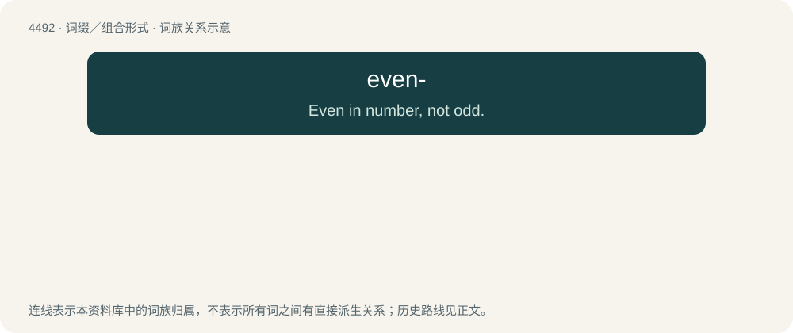

# 4492 · even- — Even in number, not odd.

[总目录](../00_总目录_按常用程度.md)

**类型**：词缀／组合形式　｜　**来源语言**：见词源记录

## 核心含义与来源

- 核心含义：Even in number, not odd.
- 英文含义：Even in number, not odd.
- 词形：even-

**来源记录 1**（前缀／前置成分；Even in number, not odd.）

From Middle English even-, efen-, from Old English efn- (“equal, fellow-, co-”), from Proto-West Germanic \*ebna- (“like-, level, equal-”, prefix/combining form), from Proto-Germanic \*ebnaz (“equal, even”); same as Old English efn (“equal, even, level”). More at even. Cognate with Scots evin- (“equal-”), Old Frisian ivin-, evn- (“even-”), Dutch even-, Old High German eban- (“even-”).

## 词族图

