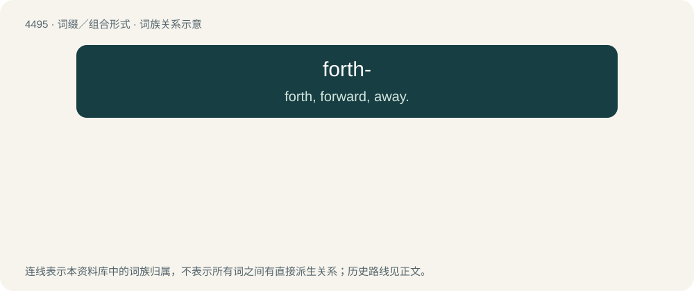

# 4495 · forth- — forth, forward, away.

[总目录](../00_总目录_按常用程度.md)

**类型**：词缀／组合形式　｜　**来源语言**：见词源记录

## 核心含义与来源

- 核心含义：forth, forward, away.
- 英文含义：forth, forward, away.
- 词形：forth-

**来源记录 1**（前缀／前置成分；forth, forward, away.）

From Middle English forth-, from Old English forþ- (“forth, forward, further, away, continually”), from Proto-West Germanic \*forþ, from Proto-Germanic \*furþą (“forth, forward”), from Proto-Indo-European \*prto-. More at forth.

## 词族图

