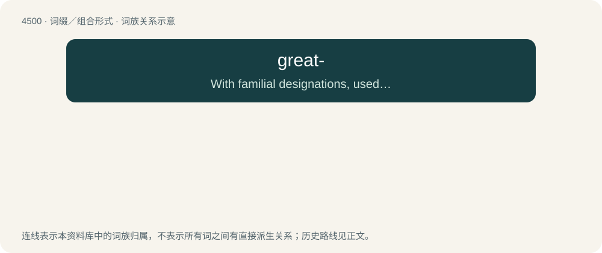

# 4500 · great- — With familial designations, used to denote a removal of one generation

[总目录](../00_总目录_按常用程度.md)

**类型**：词缀／组合形式　｜　**来源语言**：见词源记录

## 核心含义与来源

- 核心含义：With familial designations, used to denote a removal of one generation
- 英文含义：With familial designations, used to denote a removal of one generation
- 词形：great-

**来源记录 1**（前缀／前置成分；With familial designations, used to denote a removal of one generation）

From Middle English gret- (“great-”), from gret (“great”). More at great.

## 词族图

