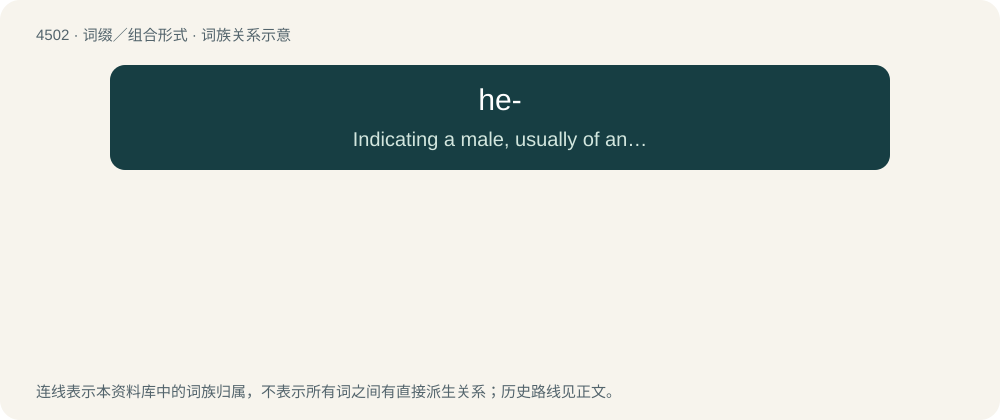

# 4502 · he- — Indicating a male, usually of an animal.

[总目录](../00_总目录_按常用程度.md)

**类型**：词缀／组合形式　｜　**来源语言**：见词源记录

## 核心含义与来源

- 核心含义：Indicating a male, usually of an animal.
- 英文含义：Indicating a male, usually of an animal.
- 词形：he-

## 词族图

