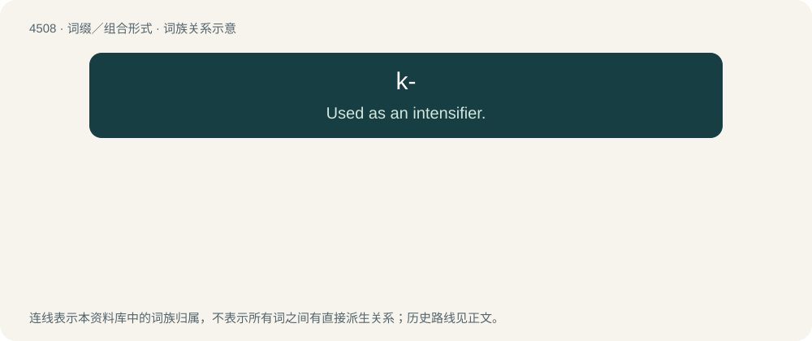

# 4508 · k- — Used as an intensifier.

[总目录](../00_总目录_按常用程度.md)

**类型**：词缀／组合形式　｜　**来源语言**：见词源记录

## 核心含义与来源

- 核心含义：Used as an intensifier.
- 英文含义：Used as an intensifier.
- 词形：k-

**来源记录 1**（前缀／前置成分；Used as an intensifier.）

Uncertain. Perhaps from OK, in phrases like OK, cool; perhaps from the K prefix for kilo-, as in kilobyte.

## 词族图

