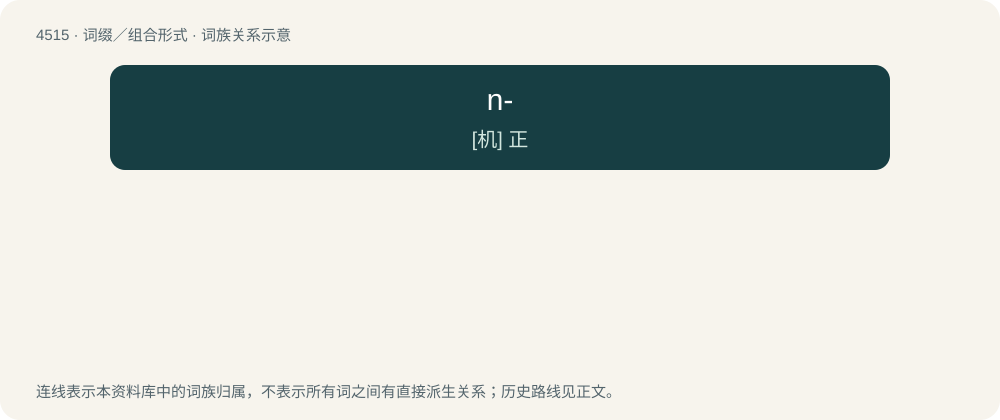

# 4515 · n- — \[机\] 正

[总目录](../00_总目录_按常用程度.md)

**类型**：词缀／组合形式　｜　**来源语言**：见词源记录

## 核心含义与来源

- 核心含义：\[机\] 正
- 英文含义：Indicating an arbitrary number of elements.
- 词形：n-

**多个词源／构词路径**：同一拼写可能有不同来源；以下按词性和含义分别列出。

**来源记录 1**（前缀／前置成分；Indicating an arbitrary number of elements.）

Abbreviation of number. Borrowed from German n-.

**来源记录 2**（前缀／前置成分；The normal-form of a functional group (or molecule), being the long-chain form (the unbranched chain).）

Abbreviation of normal.

## 词族图

