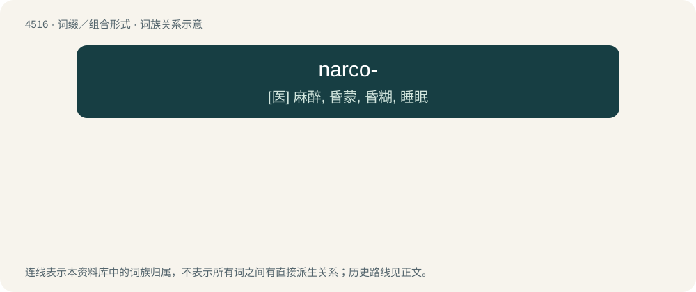

# 4516 · narco- — \[医\] 麻醉, 昏蒙, 昏糊, 睡眠

[总目录](../00_总目录_按常用程度.md)

**类型**：词缀／组合形式　｜　**来源语言**：见词源记录

## 核心含义与来源

- 核心含义：\[医\] 麻醉, 昏蒙, 昏糊, 睡眠
- 英文含义：Pertaining to stupor, sleep, or a state of unconsciousness.
- 词形：narco-

**来源记录 1**（前缀／前置成分；Pertaining to stupor, sleep, or a state of unconsciousness.）

From Ancient Greek ναρκόω (narkóō, “I put to sleep”); in terms relating to drugs, it is a back-formation from narcotics, which ultimately derives from the same source.

## 词族图

