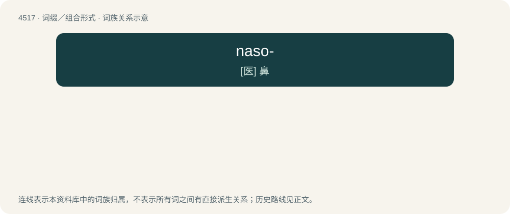

# 4517 · naso- — \[医\] 鼻

[总目录](../00_总目录_按常用程度.md)

**类型**：词缀／组合形式　｜　**来源语言**：见词源记录

## 核心含义与来源

- 核心含义：\[医\] 鼻
- 英文含义：Relating to the nose.
- 词形：naso-

**来源记录 1**（前缀／前置成分；Relating to the nose.）

From Latin nāsus (“nose”) + English -o-.

## 词族图

