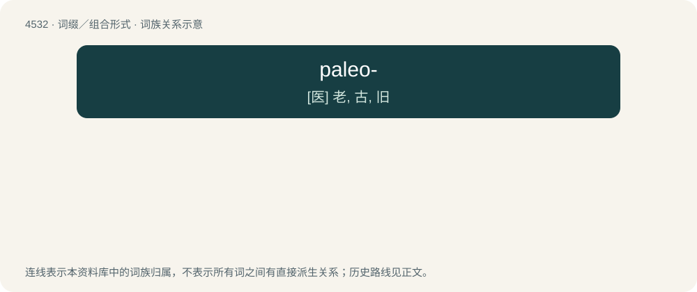

# 4532 · paleo- — \[医\] 老, 古, 旧

[总目录](../00_总目录_按常用程度.md)

**类型**：词缀／组合形式　｜　**来源语言**：见词源记录

## 核心含义与来源

- 核心含义：\[医\] 老, 古, 旧
- 英文含义：Old; ancient or primitive.
- 词形：paleo-

**来源记录 1**（前缀／前置成分；Old; ancient or primitive.）

From Ancient Greek παλαιός (palaiós, “old”).

## 词族图

