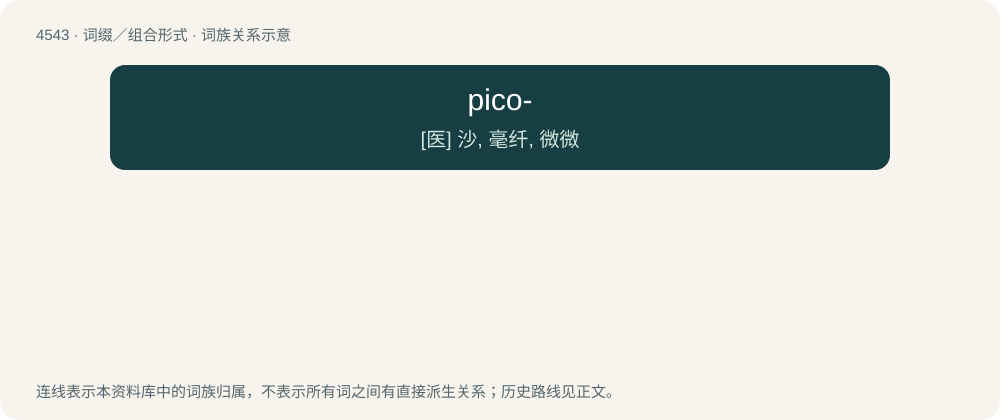

# 4543 · pico- — \[医\] 沙, 毫纤, 微微

[总目录](../00_总目录_按常用程度.md)

**类型**：词缀／组合形式　｜　**来源语言**：见词源记录

## 核心含义与来源

- 核心含义：\[医\] 沙, 毫纤, 微微
- 英文含义：In the International System of Units and other metric systems of units, multiplying the unit to which it is attached by 10⁻¹² (short scale trillionth or long scale billionth).
- 词形：pico-

**来源记录 1**（前缀／前置成分；In the International System of Units and other metric systems of units, multiplying the unit to which it is attached by 10⁻¹² (short scale trillionth or long scale billionth).）

Borrowed from Spanish pico (“beak, little bit, speck”)

## 词族图

