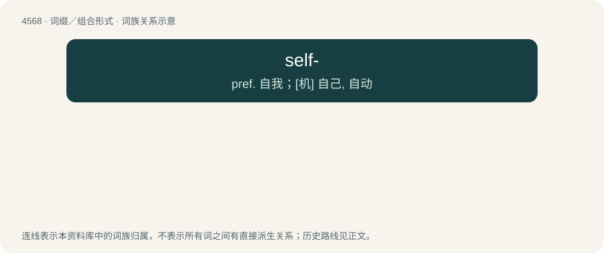

# 4568 · self- — pref. 自我；\[机\] 自己, 自动

[总目录](../00_总目录_按常用程度.md)

**类型**：词缀／组合形式　｜　**来源语言**：见词源记录

## 核心含义与来源

- 核心含义：pref. 自我；\[机\] 自己, 自动
- 英文含义：of, by, in or with oneself or itself
- 词形：self-

**来源记录 1**（前缀／前置成分；of, by, in or with oneself or itself）

From Middle English self-, silf-, seolf-, from Old English self-, sylf-, seolf-, from Proto-Germanic \*selba-, from Proto-Germanic \*selbaz (“self”). Cognate with Dutch zelf- (“self-”), German Low German sülvst- (“self-”), German selbst- (“self-”), Swedish själv- (“self-”), Icelandic sjálf- (“self-”). More at self.

## 词族图

