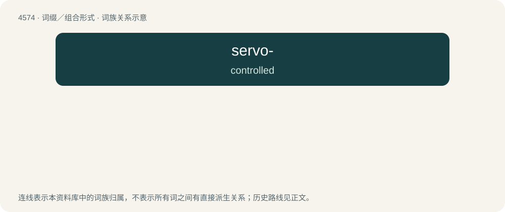

# 4574 · servo- — controlled

[总目录](../00_总目录_按常用程度.md)

**类型**：词缀／组合形式　｜　**来源语言**：见词源记录

## 核心含义与来源

- 核心含义：controlled
- 英文含义：controlled
- 词形：servo-

**来源记录 1**（前缀／前置成分；controlled）

Derived from Latin servus (“slave”).

## 词族图

