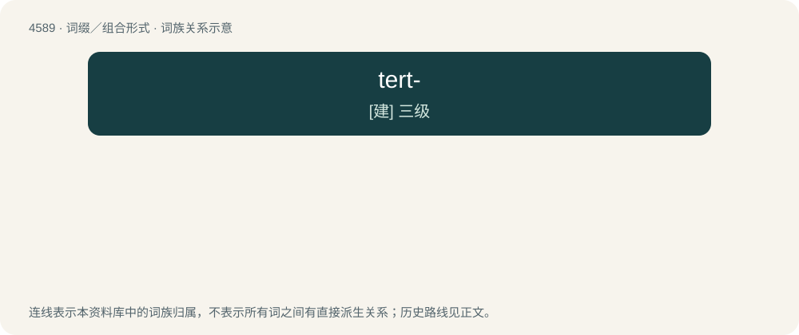

# 4589 · tert- — \[建\] 三级

[总目录](../00_总目录_按常用程度.md)

**类型**：词缀／组合形式　｜　**来源语言**：见词源记录

## 核心含义与来源

- 核心含义：\[建\] 三级
- 英文含义：tertiary form.
- 词形：tert-

**来源记录 1**（前缀／前置成分；tertiary form.）

Derived from Latin tertius (“third”).

## 词族图

