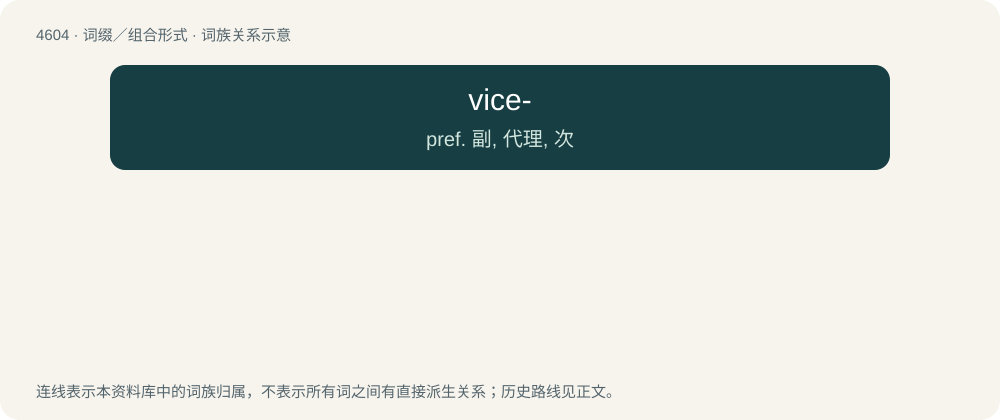

# 4604 · vice- — pref. 副, 代理, 次

[总目录](../00_总目录_按常用程度.md)

**类型**：词缀／组合形式　｜　**来源语言**：见词源记录

## 核心含义与来源

- 核心含义：pref. 副, 代理, 次
- 英文含义：Taking the place or rank of (another person); deputy.
- 词形：vice-

**来源记录 1**（前缀／前置成分；Taking the place or rank of (another person); deputy.）

Derived from Latin vice (“in place of”), ablative form of vicis (“alternation, turn”). Compare viscount.

## 词族图

