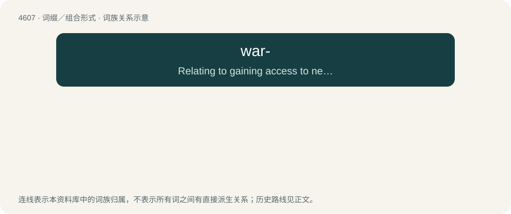

# 4607 · war- — Relating to gaining access to network resources, such as Wi-Fi, by locating and exploiting unprotected access addresses.

[总目录](../00_总目录_按常用程度.md)

**类型**：词缀／组合形式　｜　**来源语言**：见词源记录

## 核心含义与来源

- 核心含义：Relating to gaining access to network resources, such as Wi-Fi, by locating and exploiting unprotected access addresses.
- 英文含义：Relating to gaining access to network resources, such as Wi-Fi, by locating and exploiting unprotected access addresses.
- 词形：war-

**来源记录 1**（前缀／前置成分；Relating to gaining access to network resources, such as Wi-Fi, by locating and exploiting unprotected access addresses.）

From the 1983 movie WarGames, which featured war-dialing.

## 词族图

