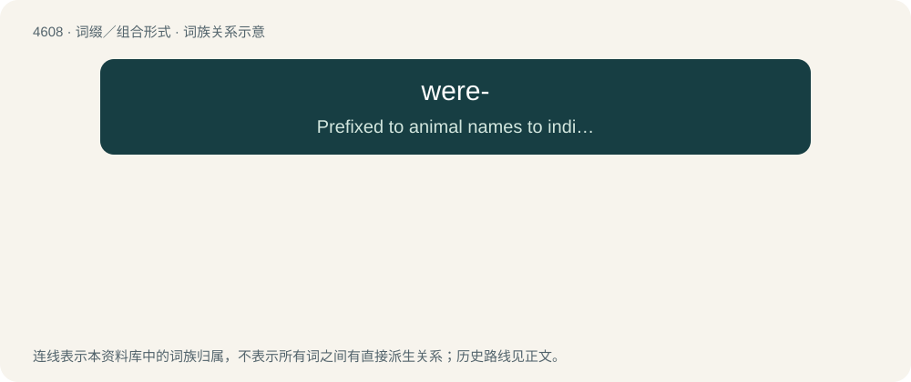

# 4608 · were- — Prefixed to animal names to indicate a human that shapeshifts into that animal.

[总目录](../00_总目录_按常用程度.md)

**类型**：词缀／组合形式　｜　**来源语言**：见词源记录

## 核心含义与来源

- 核心含义：Prefixed to animal names to indicate a human that shapeshifts into that animal.
- 英文含义：Prefixed to animal names to indicate a human that shapeshifts into that animal.
- 词形：were-

**来源记录 1**（前缀／前置成分；Prefixed to animal names to indicate a human that shapeshifts into that animal.）

Back-formation from werewolf (“man-wolf”), from Old English werewulf, derived from wer (“man”) + wulf (“wolf”).

## 词族图

